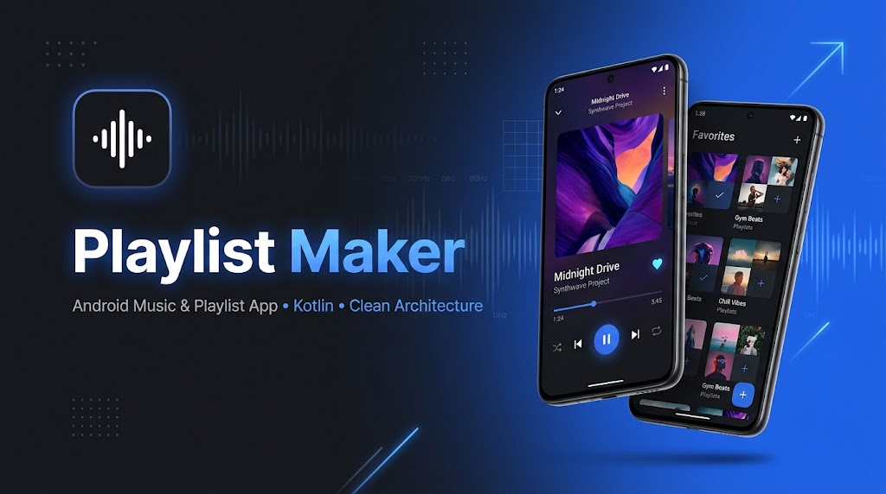

<p align="center">
  <b>🇬🇧 English</b> | <a href="README.ru.md">🇷🇺 Русский</a>
</p>

<h1 align="center">🎵 Playlist Maker</h1>

<p align="center">
  <b>A modern Android music discovery, audio preview, and playlist management app built with Kotlin, Clean Architecture, and MVVM.</b>
</p>

<p align="center">
  
  
  
  
  
  
  
</p>

<p align="center">
  
</p>

---

## 📖 Overview

**Playlist Maker** is an Android application developed as a comprehensive capstone portfolio project. It lets users search millions of songs via the **Apple iTunes Search API**, listen to 30-second audio previews, save favorite tracks, build and customize personal playlists with cover images, and share tracklists with friends.

The codebase demonstrates production-ready Android engineering practices: feature-oriented **Clean Architecture**, **Single-Activity** navigation, reactive data streams with **Kotlin Coroutines & Flow**, **Room** persistence with **KSP**, and dependency injection with **Koin**.

---

## ✨ Key Features

- 🔍 **Music Search & Search History**
  - Real-time track search via the iTunes Search API with coroutine-based input **debounce** (`2000 ms`) and click debounce.
  - Persistent search history (up to 10 recent tracks) stored in `SharedPreferences` via `Gson`.
  - Explicit UI state rendering (`Loading`, `Content`, `Empty`, `Network Error` with instant retry, and `History`).

- 🎧 **Audio Preview Player**
  - Streams 30-second track previews using Android `MediaPlayer` abstracted behind clean domain interfaces.
  - Real-time playback timer updated via coroutines (`300 ms` interval) and automatic lifecycle-aware pause when the app goes to the background.
  - High-resolution album artwork (`512x512`) loaded and rounded with **Glide**.
  - Instant **Favorites** toggle and a modal **Bottom Sheet** to add the current track to any existing or newly created playlist.

- 📚 **Media Library**
  - Organized with `ViewPager2` and `TabLayout` into two sections: **Favorite Tracks** and **Playlists** (2-column `GridLayoutManager`).
  - Reactive updates via Room `Flow` — changes to favorites or playlists reflect immediately without manual refreshes.

- 💿 **Full Playlist Management (CRUD & Sharing)**
  - **Create & Edit Playlists**: Pick cover art via the system **Android Photo Picker** (`PickVisualMedia` — zero storage permissions required), compress and persist images in private app storage, validate required fields, and guard against accidental data loss with an exit confirmation dialog.
  - **Playlist Details Screen**: Dual `BottomSheetBehavior` layout (persistent tracklist sheet + hideable overflow menu sheet with dim overlay), automatic total duration calculation, and localized pluralized counters.
  - **Smart Storage Cleanup**: Removing a track from a playlist or deleting a playlist automatically checks all remaining playlists and purges orphaned track records from SQLite.
  - **Share Tracklist**: Exports a formatted, numbered tracklist with durations via the native Android Sharesheet (`Intent.ACTION_SEND`).

- 🎨 **Theme & App Settings**
  - Persistent **Light / Dark mode** toggle (`AppCompatDelegate`) applied at app startup.
  - Share app link, contact support via email (`ACTION_SENDTO`), and open user agreement (`ACTION_VIEW`) cleanly decoupled from the Domain/UI layers via `ExternalNavigator`.

---

## 🏗️ Architecture & Engineering Highlights

The project follows **Clean Architecture** combined with **MVVM** in the presentation layer, organized by feature packages:

```text
com.artspb.playlistmaker
├── di/              # Koin DI modules (Data, Repository, Interactor, ViewModel)
├── main/            # Single-Activity host (MainActivity) + BottomNavigationView
├── search/          # Track search (Retrofit2) & local search history (SharedPreferences)
│   ├── data/        # DTOs, Retrofit API service, NetworkClient, Repository impls
│   ├── domain/      # Pure Kotlin models, Repository & Interactor interfaces/impls
│   └── ui/          # SearchFragment, SearchViewModel, sealed SearchState, TrackAdapter
├── player/          # Audio preview playback & "Add to Playlist" Bottom Sheet
│   ├── data/        # AndroidAudioPlayerImpl (MediaPlayer wrapper)
│   ├── domain/      # AudioPlayerControl, AudioPlayerInteractor, PlayerState
│   └── ui/          # AudioPlayerFragment, MediaViewModel, PlaylistBottomSheetAdapter
├── medialibrary/    # Favorites, Playlists Grid, Create/Edit Playlist, Playlist Details
│   ├── data/        # Room AppDatabase, DAOs, Entities, DB converters, private file storage
│   ├── domain/      # Favorites & Playlists Interactors/Repositories, Playlist model
│   └── ui/          # Fragments, ViewModels (with inheritance reuse for Create/Edit)
├── settings/        # Dark/Light theme switching & persistence
├── sharing/         # External intents abstraction (Sharesheet, Email, Browser)
└── util/            # Reusable utilities (SingleLiveData for one-shot UI events)
```

### Why it's built this way:
- **Strict Layer Boundaries**: The `domain` layer contains zero Android framework dependencies (`Context`, `Intent`, `Uri`, Room `@Entity`, or Retrofit annotations), keeping business rules clean and testable.
- **One-Shot Event Safety**: Uses custom `SingleLiveData<T>` backed by `AtomicBoolean` so navigation actions and `Snackbar` notifications never fire twice on screen rotation.
- **Inheritance for Screen Reuse**: `EditPlaylistFragment` and `EditPlaylistViewModel` extend `CreatePlaylistFragment` and `CreatePlaylistViewModel`, reusing layout, Photo Picker handling, and input validation without code duplication.
- **Modern Build Setup**: Gradle Kotlin DSL (`build.gradle.kts`), Version Catalog (`libs.versions.toml`), SafeArgs, ViewBinding, and **KSP** (instead of legacy `kapt`) for fast Room compilation.

---

## 🛠️ Tech Stack

| Category | Technologies & Libraries |
| :--- | :--- |
| **Language** | Kotlin `2.0.21` |
| **Architecture** | Clean Architecture, MVVM, Single-Activity |
| **Concurrency & Reactive** | Kotlin Coroutines, Kotlin `Flow`, `LiveData`, `SingleLiveData` |
| **Dependency Injection** | Koin `3.3.0` |
| **Navigation** | Jetpack Navigation Component (`2.7.7`), SafeArgs |
| **Networking & Serialization** | Retrofit `2.9.0`, Gson, Apple iTunes Search REST API |
| **Local Storage** | Room Database `2.6.1` (with KSP), `SharedPreferences`, Internal Storage (`Bitmap` compression) |
| **UI & Media** | Material Design Components (`BottomSheetBehavior`, `TabLayout`, `Snackbar`, Dialogs), `ViewPager2`, `RecyclerView`, `ConstraintLayout`, ViewBinding, Glide `4.16.0`, `MediaPlayer`, Android Photo Picker (`PickVisualMedia`), Edge-to-Edge Window Insets |
| **Build Tools** | Gradle Kotlin DSL, Version Catalog (`libs.versions.toml`), KSP |

---

## 🚀 Getting Started

No API keys or registration are required — the app uses the public Apple iTunes Search API.

1. **Clone the repository:**
   ```bash
   git clone https://github.com/Artem-SPb/PlaylistMaker.git
   cd PlaylistMaker
   ```
2. **Open in Android Studio:**
   - Android Studio Ladybug (or newer) recommended.
   - JDK `17` or `21` configured in Gradle settings.
3. **Build and run:**
   - Sync Gradle and run the `app` configuration on an emulator or physical device running **Android 10 (API 29)** or higher, or build from the terminal:
   ```bash
   ./gradlew assembleDebug
   ```

---

## 👤 Author

**Artem** — [@Artem-SPb](https://github.com/Artem-SPb)
