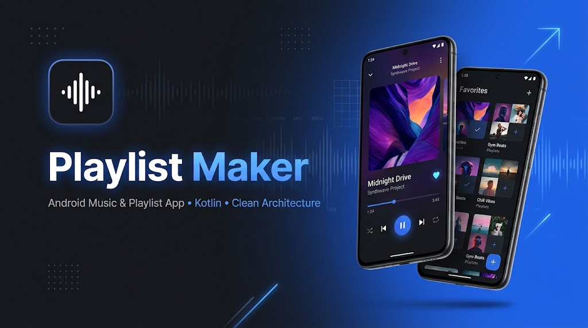

<p align="center">
  <a href="README.md">🇬🇧 English</a> | <b>🇷🇺 Русский</b>
</p>

<h1 align="center">🎵 Playlist Maker</h1>

<p align="center">
  <b>Современное Android-приложение для поиска музыки, прослушивания превью треков и управления собственными плейлистами на Kotlin, Clean Architecture и MVVM.</b>
</p>

<p align="center">
  
  
  
  
  
  
  
</p>

<p align="center">
  
</p>

---

## 📖 О проекте

**Playlist Maker** — полнофункциональное Android-приложение, разработанное в качестве итогового учебного и портфолио-проекта. Приложение позволяет искать музыку через открытый **Apple iTunes Search API**, слушать 30-секундные отрывки треков, добавлять любимые композиции в «Избранное», создавать и редактировать собственные плейлисты с обложками, а также делиться списками треков в мессенджерах и соцсетях.

Проект демонстрирует актуальный стек и инженерные подходы современной Android-разработки: многослойную **Clean Architecture**, навигацию по принципу **Single-Activity**, асинхронную и реактивную работу с данными на **Kotlin Coroutines & Flow**, локальное хранение в **Room (KSP)** и внедрение зависимостей с помощью **Koin**.

---

## ✨ Основной функционал

- 🔍 **Поиск музыки и история запросов**
  - Живой поиск треков в каталоге iTunes с автоматическим **debounce** ввода (`2000 мс`) на корутинах и защитой от двойных нажатий.
  - Сохранение истории прослушанных треков (до 10 последних композиций) в `SharedPreferences` с сериализацией через `Gson`.
  - Чёткое управление состояниями экрана (`Loading`, `Content`, `Empty`, `Error` с кнопкой повторного запроса и `History`).

- 🎧 **Аудиоплеер**
  - Потоковое воспроизведение 30-секундного превью трека на базе `MediaPlayer`, изолированного за интерфейсами доменного слоя.
  - Реактивный таймер прогресса воспроизведения на корутинах (`300 мс`) и автоматическая постановка на паузу при сворачивании приложения (`onPause`).
  - Загрузка обложек в высоком разрешении (`512x512`) со скруглением углов через **Glide**.
  - Мгновенное добавление/удаление из «Избранного» и выезжающая шторка (**Bottom Sheet**) для добавления трека в существующий или новый плейлист.

- 📚 **Медиатека**
  - Экран с вкладками на базе `ViewPager2` и `TabLayout`: **«Избранные треки»** и **«Плейлисты»** (сетка в 2 колонки через `GridLayoutManager`).
  - Реактивная подписка на БД через Room `Flow` — любые изменения сразу отображаются в интерфейсе.

- 💿 **Управление плейлистами (полный цикл CRUD и шаринг)**
  - **Создание и редактирование**: выбор обложки через системный **Android Photo Picker** (`PickVisualMedia` без запроса лишних разрешений на чтение хранилища), сжатие и сохранение изображений во внутреннее приватное хранилище приложения, валидация полей и защита от случайной потери введённых данных диалогом подтверждения.
  - **Экран «Плейлист»**: комбинация двух `BottomSheetBehavior` (постоянная шторка со списком треков и скрываемое меню действий с затемнением фона), автоматический подсчёт суммарной длительности в минутах и склонение числительных через `plurals`.
  - **Умная очистка БД**: при удалении трека из плейлиста или удалении всего плейлиста репозиторий проверяет остальные плейлисты и автоматически удаляет неиспользуемые треки из таблицы `playlist_tracks_table`.
  - **Шаринг плейлиста**: формирование текстового нумерованного списка треков с длительностью и отправка через системное меню Android (`Intent.ACTION_SEND`).

- 🎨 **Настройки и темизация**
  - Переключение **светлой и тёмной темы** (`AppCompatDelegate`) с сохранением выбора пользователя при следующем запуске.
  - Шаринг ссылки на приложение, отправка письма в поддержку (`ACTION_SENDTO`) и открытие пользовательского соглашения (`ACTION_VIEW`) через абстракцию `ExternalNavigator`.

---

## 🏗️ Архитектура и инженерные решения

Код разделён по фичам (`feature-by-package`) и следует принципам **Clean Architecture** + **MVVM**:

```text
com.artspb.playlistmaker
├── di/              # Модули Koin (Data, Repository, Interactor, ViewModel)
├── main/            # Единственная Activity (MainActivity) + BottomNavigationView
├── search/          # Поиск треков (Retrofit2) и история поиска (SharedPreferences)
│   ├── data/        # DTO, сервис iTunes API, NetworkClient, реализации репозиториев
│   ├── domain/      # Чистые доменные модели, интерфейсы и реализации интеракторов
│   └── ui/          # SearchFragment, SearchViewModel, sealed SearchState, TrackAdapter
├── player/          # Аудиоплеер и Bottom Sheet добавления трека в плейлист
│   ├── data/        # AndroidAudioPlayerImpl (обёртка над MediaPlayer)
│   ├── domain/      # AudioPlayerControl, AudioPlayerInteractor, PlayerState
│   └── ui/          # AudioPlayerFragment, MediaViewModel, PlaylistBottomSheetAdapter
├── medialibrary/    # Избранное, список плейлистов, создание/редактирование, экран плейлиста
│   ├── data/        # База данных Room, DAO, Entity, конвертеры, работа с файлами обложек
│   ├── domain/      # Интеракторы и репозитории избранного и плейлистов, модель Playlist
│   └── ui/          # Фрагменты и ViewModel (включая переиспользование кода через наследование)
├── settings/        # Управление светлой/тёмной темой приложения
├── sharing/         # Навигация во внешние приложения (шаринг, почта, браузер)
└── util/            # Переиспользуемые утилиты (SingleLiveData для одноразовых событий)
```

### Ключевые технические акценты:
- **Чистый слой Domain**: доменный слой полностью независим от Android SDK (`Context`, `Intent`, `Uri`), сетевых DTO и сущностей Room.
- **Безопасная обработка One-shot событий**: собственный класс `SingleLiveData<T>` на основе `AtomicBoolean` предотвращает повторный показ `Snackbar` и лишние переходы при повороте экрана.
- **Переиспользование через ООП**: экран и логика редактирования (`EditPlaylistFragment` / `EditPlaylistViewModel`) наследуются от базовых классов создания плейлиста, избавляя проект от дублирования вёрстки и валидации.
- **Современная сборка**: Gradle Kotlin DSL (`build.gradle.kts`), каталог версий (`libs.versions.toml`), SafeArgs, ViewBinding и кодогенерация Room через **KSP** вместо устаревшего `kapt`.

---

## 🛠️ Технологический стек

| Категория | Технологии и библиотеки |
| :--- | :--- |
| **Язык** | Kotlin `2.0.21` |
| **Архитектура** | Clean Architecture, MVVM, Single-Activity |
| **Асинхронность и реактивность** | Kotlin Coroutines, Kotlin `Flow`, `LiveData`, `SingleLiveData` |
| **Внедрение зависимостей (DI)** | Koin `3.3.0` |
| **Навигация** | Jetpack Navigation Component (`2.7.7`), SafeArgs |
| **Сеть и сериализация** | Retrofit `2.9.0`, Gson, Apple iTunes Search REST API |
| **Хранение данных** | Room Database `2.6.1` (KSP), `SharedPreferences`, Internal Storage (сжатие `Bitmap`) |
| **UI и мультимедиа** | Material Design Components (`BottomSheetBehavior`, `TabLayout`, `Snackbar`, диалоги), `ViewPager2`, `RecyclerView`, `ConstraintLayout`, ViewBinding, Glide `4.16.0`, `MediaPlayer`, Android Photo Picker (`PickVisualMedia`), Edge-to-Edge Insets |
| **Сборка** | Gradle Kotlin DSL, Version Catalog (`libs.versions.toml`), KSP |

---

## 🚀 Как запустить проект

Для работы приложения не требуются API-ключи — используется публичный Apple iTunes Search API.

1. **Клонируйте репозиторий:**
   ```bash
   git clone https://github.com/Artem-SPb/PlaylistMaker.git
   cd PlaylistMaker
   ```
2. **Откройте проект в Android Studio:**
   - Рекомендуется Android Studio Ladybug или новее.
   - В настройках Gradle должен быть выбран JDK `17` или `21`.
3. **Запустите сборку:**
   - Дождитесь синхронизации Gradle и запустите конфигурацию `app` на эмуляторе или устройстве с **Android 10 (API 29)** и выше, либо соберите APK из терминала:
   ```bash
   ./gradlew assembleDebug
   ```

---

## 👤 Автор

**Артём** — [@Artem-SPb](https://github.com/Artem-SPb)
